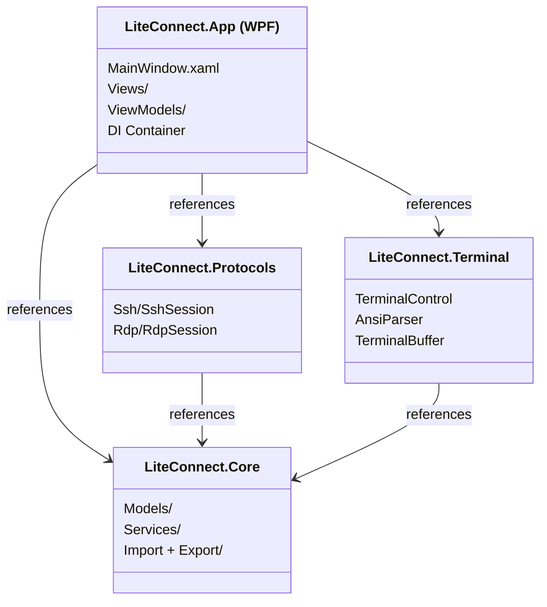
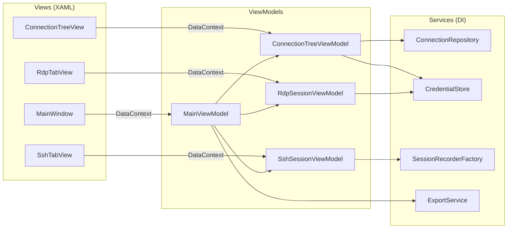

# 🛠️ LiteConnect — Phase 1 Implementation Guide

> Companion to [plan.md](file:///C:/Users/mathe/.gemini/antigravity/brain/6b594cf7-2577-469b-a7d3-f6b4e1b11988/plan.md) — this document has the detailed architecture, interface contracts, database schema, and sprint-level task checklists needed to start building.

---

## 1. Layered Architecture (Detailed)



### Dependency Rules
- **App** → references everything (composition root)
- **Core** → references nothing (pure business logic, models, interfaces)
- **Protocols** → references Core only (implements `IProtocolSession`)
- **Terminal** → references Core only (terminal control is protocol-agnostic)

---

## 2. Core Interface Contracts

These are the key abstractions that all components program against.

### 2.1 IProtocolSession — Protocol Abstraction

```csharp
// LiteConnect.Core/Abstractions/IProtocolSession.cs
public interface IProtocolSession : IDisposable
{
    /// Unique session ID
    Guid SessionId { get; }

    /// Display name for the tab header
    string DisplayName { get; }

    /// Current connection state
    SessionState State { get; }

    /// The protocol type (SSH, RDP, VNC)
    ProtocolType Protocol { get; }

    /// Fires when state changes (Connecting → Connected → Disconnected)
    event EventHandler<SessionStateChangedEventArgs> StateChanged;

    /// Fires when the session wants to display a notification
    event EventHandler<SessionNotificationEventArgs> NotificationRaised;

    /// Connect using the provided connection info
    Task ConnectAsync(ConnectionInfo connectionInfo, CancellationToken ct = default);

    /// Gracefully disconnect
    Task DisconnectAsync();

    /// Get the WPF UIElement that renders this session's content
    /// (TerminalControl for SSH, WindowsFormsHost for RDP)
    FrameworkElement GetSessionControl();

    /// Called when the tab is resized
    void OnResize(int width, int height);

    /// Can this session be reconnected after disconnect?
    bool CanReconnect { get; }
}

public enum SessionState
{
    Idle,
    Connecting,
    Connected,
    Disconnecting,
    Disconnected,
    Error
}
```

### 2.2 ICredentialStore — Encrypted Credential Storage

```csharp
// LiteConnect.Core/Abstractions/ICredentialStore.cs
public interface ICredentialStore : IDisposable
{
    /// Current encryption mode
    EncryptionMode Mode { get; }

    /// Initialize the store — auto-detects mode from settings
    /// DPAPI mode: opens silently, returns true
    /// Master password mode: returns false (caller must call UnlockWithPasswordAsync)
    Task<bool> InitializeAsync();

    /// Unlock with master password (only needed if Mode == MasterPassword)
    Task<bool> UnlockWithPasswordAsync(string masterPassword);

    /// Lock the store (clear in-memory keys)
    void Lock();

    /// Is the store currently unlocked and ready?
    bool IsUnlocked { get; }

    /// Store credentials for a connection
    Task SaveCredentialAsync(Guid connectionId, Credential credential);

    /// Retrieve credentials for a connection (decrypted in memory)
    Task<Credential?> GetCredentialAsync(Guid connectionId);

    /// Delete credentials for a connection
    Task DeleteCredentialAsync(Guid connectionId);

    /// Switch encryption mode (re-encrypts the database)
    /// newPassword is required when switching TO MasterPassword mode
    Task SwitchModeAsync(EncryptionMode newMode, string? newPassword = null);

    /// Change the master password (only valid in MasterPassword mode)
    Task ChangeMasterPasswordAsync(string oldPassword, string newPassword);
}

public enum EncryptionMode
{
    Dpapi,           // Default — Windows DPAPI, no password prompt
    MasterPassword   // Opt-in — user-set password required on startup
}

public record Credential(
    string? Username,
    string? Password,
    string? Domain,
    string? PrivateKeyPath,
    string? KeyPassphrase
);
```

### 2.3 IConnectionRepository — Connection Tree Persistence

```csharp
// LiteConnect.Core/Abstractions/IConnectionRepository.cs
public interface IConnectionRepository
{
    /// Load the entire connection tree (groups + connections)
    Task<ConnectionGroup> LoadTreeAsync();

    /// Save/update a connection
    Task SaveConnectionAsync(ConnectionInfo connection);

    /// Save/update a group (folder)
    Task SaveGroupAsync(ConnectionGroup group);

    /// Delete a connection by ID
    Task DeleteConnectionAsync(Guid id);

    /// Delete a group and optionally its children
    Task DeleteGroupAsync(Guid id, bool recursive = false);

    /// Move a connection to a different group
    Task MoveConnectionAsync(Guid connectionId, Guid targetGroupId, int sortOrder);

    /// Move a group to a different parent group
    Task MoveGroupAsync(Guid groupId, Guid targetParentId, int sortOrder);

    /// Search connections by name, host, or username
    Task<IReadOnlyList<ConnectionInfo>> SearchAsync(string query);
}
```

### 2.4 ISessionRecorder — SSH Session Recording

```csharp
// LiteConnect.Core/Abstractions/ISessionRecorder.cs
public interface ISessionRecorder : IDisposable
{
    /// Is recording currently active?
    bool IsRecording { get; }

    /// Path to the current log file (null if not recording)
    string? CurrentLogPath { get; }

    /// Start recording to a file
    Task StartAsync(string filePath, RecordingFormat format);

    /// Stop recording and flush buffer
    Task StopAsync();

    /// Pause recording (data is discarded while paused)
    void Pause();

    /// Resume after pause
    void Resume();

    /// Write data from the SSH stream (called by the recording tap)
    void Write(ReadOnlySpan<byte> data, DateTimeOffset timestamp);

    /// Fires when recording state changes
    event EventHandler<RecordingStateChangedEventArgs> StateChanged;
}

public enum RecordingFormat
{
    PlainText,      // Strip ANSI, raw text
    Timestamped,    // Strip ANSI, prefix each line with [timestamp]
    Html            // Convert ANSI colors to HTML/CSS
}
```

### 2.5 IExportService / IImportService

```csharp
// LiteConnect.Core/Abstractions/IExportService.cs
public interface IExportService
{
    Task ExportAsync(ExportOptions options, Stream outputStream, CancellationToken ct = default);
}

public interface IImportService
{
    /// Detect what format a file is (LCX, CSV, mRemoteNG XML)
    Task<ImportFileInfo> InspectFileAsync(Stream inputStream);

    /// Parse the file and return a preview tree (without importing)
    Task<ImportPreview> PreviewAsync(Stream inputStream, string? password = null);

    /// Import connections into the repository
    Task<ImportResult> ImportAsync(ImportPreview preview, ImportOptions options);
}

public record ExportOptions(
    IReadOnlyList<Guid> ConnectionIds,
    ExportFormat Format,
    bool IncludeCredentials,
    bool IncludeSshKeys,
    bool PreserveFolderStructure,
    string? Password              // for encrypted LCX format
);

public enum ExportFormat { EncryptedLcx, SessionsOnlyLcx, Csv, MRemoteNGXml }
```

---

## 3. Database Schema (SQLCipher)

Single file: `data/connections.db` — encrypted with AES-256 via SQLCipher.

```sql
-- ============================================
-- Connection Groups (folders in the tree)
-- ============================================
CREATE TABLE ConnectionGroups (
    Id              TEXT PRIMARY KEY,       -- GUID
    Name            TEXT NOT NULL,
    ParentId        TEXT,                   -- NULL = root level
    SortOrder       INTEGER DEFAULT 0,
    IsExpanded      INTEGER DEFAULT 1,      -- UI state: tree node expanded?
    -- Inherited settings (nullable = "inherit from parent")
    DefaultUsername  TEXT,
    DefaultDomain   TEXT,
    DefaultProtocol TEXT,                   -- 'SSH', 'RDP', 'VNC'
    CreatedAt       TEXT NOT NULL,          -- ISO 8601
    UpdatedAt       TEXT NOT NULL,
    FOREIGN KEY (ParentId) REFERENCES ConnectionGroups(Id) ON DELETE CASCADE
);

-- ============================================
-- Connections
-- ============================================
CREATE TABLE Connections (
    Id              TEXT PRIMARY KEY,       -- GUID
    GroupId         TEXT NOT NULL,
    Name            TEXT NOT NULL,
    Protocol        TEXT NOT NULL,          -- 'SSH', 'RDP', 'VNC'
    Hostname        TEXT NOT NULL,
    Port            INTEGER,               -- NULL = protocol default
    SortOrder       INTEGER DEFAULT 0,
    -- Credentials (encrypted at DB level via SQLCipher)
    Username        TEXT,                   -- NULL = inherit from group
    Password        TEXT,                   -- NULL = inherit or no password
    Domain          TEXT,                   -- RDP domain
    PrivateKeyPath  TEXT,                   -- SSH key file path
    KeyPassphrase   TEXT,                   -- SSH key passphrase
    -- Protocol-specific settings stored as JSON blobs
    RdpSettings     TEXT,                   -- JSON: RdpConnectionSettings
    SshSettings     TEXT,                   -- JSON: SshConnectionSettings
    VncSettings     TEXT,                   -- JSON: VncConnectionSettings
    ProxySettings   TEXT,                   -- JSON: ProxySettings
    -- Session recording settings
    AutoRecord          INTEGER DEFAULT 0,
    RecordingFormat     TEXT DEFAULT 'PlainText',
    RecordingDirectory  TEXT,               -- NULL = use global default
    RecordingFilePattern TEXT,              -- NULL = use global default
    -- Metadata
    LastConnected   TEXT,                   -- ISO 8601
    TimesConnected  INTEGER DEFAULT 0,
    Notes           TEXT,
    CreatedAt       TEXT NOT NULL,
    UpdatedAt       TEXT NOT NULL,
    FOREIGN KEY (GroupId) REFERENCES ConnectionGroups(Id) ON DELETE CASCADE
);

-- ============================================
-- Global Defaults (one row per protocol)
-- ============================================
CREATE TABLE GlobalDefaults (
    Protocol        TEXT PRIMARY KEY,       -- 'SSH', 'RDP', 'VNC'
    Settings        TEXT NOT NULL,          -- JSON blob of all default settings
    UpdatedAt       TEXT NOT NULL
);

-- ============================================
-- App Settings (key-value store)
-- ============================================
CREATE TABLE AppSettings (
    Key             TEXT PRIMARY KEY,
    Value           TEXT NOT NULL
);

-- Seed app settings
INSERT INTO AppSettings (Key, Value) VALUES
    ('schema_version', '1'),
    ('encryption_mode', 'dpapi'),                -- 'dpapi' (default) or 'master_password'
    ('master_password_hash', ''),                 -- only used in master_password mode
    ('master_password_salt', ''),                 -- only used in master_password mode
    ('default_log_directory', 'logs/'),
    ('default_log_pattern', '{connection}_{date}_{time}.log'),
    ('theme', 'dark'),
    ('auto_reconnect', 'true'),
    ('auto_lock_minutes', '30');                  -- only applies in master_password mode

-- ============================================
-- SSH Known Hosts
-- ============================================
CREATE TABLE KnownHosts (
    Hostname        TEXT NOT NULL,
    Port            INTEGER NOT NULL DEFAULT 22,
    KeyType         TEXT NOT NULL,           -- 'ssh-rsa', 'ssh-ed25519', etc.
    Fingerprint     TEXT NOT NULL,           -- SHA-256 fingerprint
    FirstSeen       TEXT NOT NULL,
    LastSeen        TEXT NOT NULL,
    Trusted         INTEGER DEFAULT 1,
    PRIMARY KEY (Hostname, Port, KeyType)
);

-- ============================================
-- Indexes
-- ============================================
CREATE INDEX IX_Connections_GroupId ON Connections(GroupId);
CREATE INDEX IX_Connections_Hostname ON Connections(Hostname);
CREATE INDEX IX_ConnectionGroups_ParentId ON ConnectionGroups(ParentId);
```

---

## 4. MVVM Data Flow



### Dependency Injection Setup

```csharp
// App.xaml.cs — Composition Root
public partial class App : Application
{
    private IHost _host;

    protected override void OnStartup(StartupEventArgs e)
    {
        _host = Host.CreateDefaultBuilder()
            .ConfigureServices((ctx, services) =>
            {
                // Core services
                services.AddSingleton<IAppEnvironment, PortableAppEnvironment>();
                services.AddSingleton<IConnectionRepository, SqliteConnectionRepository>();
                services.AddSingleton<ICredentialStore, SqlCipherCredentialStore>();
                services.AddSingleton<IGlobalDefaultsProvider, SqliteGlobalDefaultsProvider>();

                // Protocol sessions (transient — one per tab)
                services.AddTransient<SshSession>();
                services.AddTransient<RdpSession>();

                // Session recording
                services.AddTransient<ISessionRecorder, FileSessionRecorder>();
                services.AddSingleton<ISessionRecorderFactory, SessionRecorderFactory>();

                // Import/Export
                services.AddTransient<IExportService, LcxExportService>();
                services.AddTransient<IImportService, CompositeImportService>();

                // ViewModels
                services.AddSingleton<MainViewModel>();
                services.AddSingleton<ConnectionTreeViewModel>();
                services.AddTransient<SshSessionViewModel>();
                services.AddTransient<RdpSessionViewModel>();

                // Main window
                services.AddSingleton<MainWindow>();
            })
            .Build();

        var mainWindow = _host.Services.GetRequiredService<MainWindow>();
        mainWindow.Show();
    }
}
```

### Portable Environment Detection

```csharp
// LiteConnect.Core/Services/PortableAppEnvironment.cs
public class PortableAppEnvironment : IAppEnvironment
{
    public string DataDirectory { get; }
    public string LogDirectory { get; }
    public string DatabasePath { get; }
    public bool IsPortable { get; }

    public PortableAppEnvironment()
    {
        var exeDir = Path.GetDirectoryName(
            Environment.ProcessPath ?? Assembly.GetExecutingAssembly().Location)!;

        IsPortable = File.Exists(Path.Combine(exeDir, "portable.marker"));

        if (IsPortable)
        {
            DataDirectory = Path.Combine(exeDir, "data");
            LogDirectory = Path.Combine(exeDir, "logs");
        }
        else
        {
            var appData = Path.Combine(
                Environment.GetFolderPath(Environment.SpecialFolder.ApplicationData),
                "LiteConnect");
            DataDirectory = Path.Combine(appData, "data");
            LogDirectory = Path.Combine(appData, "logs");
        }

        DatabasePath = Path.Combine(DataDirectory, "connections.db");

        Directory.CreateDirectory(DataDirectory);
        Directory.CreateDirectory(LogDirectory);
    }
}
```

---

## 5. Sprint Task Checklists

> [!IMPORTANT]
> Each sprint is ~1 week. Phase 1 spans 8 sprints. Each task has acceptance criteria in parentheses.

---

### Sprint 1: Project Scaffold & WPF Shell
> **Goal**: Empty app runs, shows a window with tabbed layout and connection tree panel.

- [ ] **1.1 Create solution structure**
  - [ ] Create `LiteConnect.sln`
  - [ ] Create `src/LiteConnect.App` (WPF, .NET 8, `net8.0-windows`)
  - [ ] Create `src/LiteConnect.Core` (Class Library, `net8.0`)
  - [ ] Create `src/LiteConnect.Protocols` (Class Library, `net8.0-windows`)
  - [ ] Create `src/LiteConnect.Terminal` (WPF Custom Control Library, `net8.0-windows`)
  - [ ] Create `tests/LiteConnect.Core.Tests` (xUnit)
  - [ ] Set up project references (App → Core, Protocols, Terminal; Protocols → Core; Terminal → Core)
  - [ ] ✅ *Acceptance: `dotnet build` succeeds with zero errors*

- [ ] **1.2 Add NuGet packages**
  - [ ] `Microsoft.Extensions.Hosting` + `DependencyInjection` (App)
  - [ ] `CommunityToolkit.Mvvm` (App — for ObservableObject, RelayCommand)
  - [ ] `SQLitePCLRaw.bundle_e_sqlcipher` + `Microsoft.Data.Sqlite` (Core)
  - [ ] `SSH.NET` (Protocols)
  - [ ] `xunit` + `Moq` + `FluentAssertions` (Tests)
  - [ ] ✅ *Acceptance: `dotnet restore` succeeds, packages resolve*

- [ ] **1.3 Implement portable environment detection**
  - [ ] Create `IAppEnvironment` interface in Core
  - [ ] Create `PortableAppEnvironment` implementation
  - [ ] Create `portable.marker` in the output directory
  - [ ] ✅ *Acceptance: Unit test verifies portable vs. installed path logic*

- [ ] **1.4 Build MainWindow shell**
  - [ ] Left panel: `TreeView` placeholder (250px default width, resizable splitter)
  - [ ] Right panel: `TabControl` with closable tabs (custom tab header with ✕ button)
  - [ ] Top: Menu bar (`File`, `Edit`, `View`, `Tools`, `Help`)
  - [ ] Top: Quick Connect bar (hostname textbox + protocol dropdown + Connect button)
  - [ ] Bottom: Status bar (connection count, recording indicator)
  - [ ] ✅ *Acceptance: App launches, shows empty shell with all panels visible, tabs can be opened/closed programmatically*

- [ ] **1.5 Set up DI and MVVM foundation**
  - [ ] Configure `Host.CreateDefaultBuilder` in `App.xaml.cs`
  - [ ] Create `MainViewModel` with `ObservableCollection<ISessionTabViewModel>` for tabs
  - [ ] Create `ISessionTabViewModel` interface (DisplayName, IsActive, CloseCommand)
  - [ ] Wire `MainWindow.DataContext` to `MainViewModel`
  - [ ] Implement tab close command
  - [ ] ✅ *Acceptance: Can programmatically add/remove dummy tabs from ViewModel, UI updates*

---

### Sprint 2: Connection Tree & Persistence
> **Goal**: Users can create, edit, organize, and persist connections in a tree view.

- [ ] **2.1 Initialize SQLCipher database**
  - [ ] Create `DatabaseInitializer` service — creates DB file, runs schema DDL
  - [ ] Open DB with temporary empty passphrase (credential encryption comes in Sprint 4)
  - [ ] Seed `GlobalDefaults` rows for SSH, RDP, VNC
  - [ ] ✅ *Acceptance: On first launch, `connections.db` is created with all tables*

- [ ] **2.2 Implement ConnectionRepository**
  - [ ] Create `SqliteConnectionRepository : IConnectionRepository`
  - [ ] Implement `LoadTreeAsync` — recursive CTE to build the tree
  - [ ] Implement `SaveConnectionAsync` / `SaveGroupAsync` (upsert)
  - [ ] Implement `DeleteConnectionAsync` / `DeleteGroupAsync` (cascade)
  - [ ] Implement `MoveConnectionAsync` / `MoveGroupAsync` (update ParentId + SortOrder)
  - [ ] Implement `SearchAsync` (LIKE query on Name, Hostname, Username)
  - [ ] ✅ *Acceptance: Unit tests pass for CRUD + tree building + search with in-memory SQLite*

- [ ] **2.3 Define data models**
  - [ ] `ConnectionInfo` — Id, Name, Protocol, Hostname, Port, GroupId, credentials, settings JSON
  - [ ] `ConnectionGroup` — Id, Name, ParentId, SortOrder, Children (groups + connections)
  - [ ] `ProtocolType` enum — SSH, RDP, VNC
  - [ ] `RdpConnectionSettings`, `SshConnectionSettings`, `VncConnectionSettings` — all props nullable
  - [ ] `ProxySettings`, `PortForwardRule`
  - [ ] JSON serialization for settings blobs (System.Text.Json source generators)
  - [ ] ✅ *Acceptance: Models serialize/deserialize correctly to/from JSON; round-trip test passes*

- [ ] **2.4 Build ConnectionTreeView**
  - [ ] `ConnectionTreeViewModel` — loads tree on startup, exposes `ObservableCollection<TreeNodeViewModel>`
  - [ ] `TreeNodeViewModel` — wraps both `ConnectionGroup` and `ConnectionInfo` with IsExpanded, IsSelected
  - [ ] Right-click context menu: New Folder, New Connection, Edit, Delete, Move Up/Down
  - [ ] Double-click connection → fires `OpenConnectionCommand` (handled in Sprint 3+)
  - [ ] Drag-and-drop reordering (within tree)
  - [ ] ✅ *Acceptance: Can create folders, create connections in folders, rename, delete, reorder — all persisted to DB*

- [ ] **2.5 Connection Properties dialog (basic)**
  - [ ] Modal dialog with tabs: Connection, Display, Gateway, Resources, SSH, Terminal, Proxy, Advanced
  - [ ] Only show tabs relevant to the selected protocol
  - [ ] "Connection" tab: Name, Protocol dropdown, Hostname, Port, Username, Password
  - [ ] OK / Cancel / Apply buttons
  - [ ] ✅ *Acceptance: Can create and edit a connection; changes persist to DB*

---

### Sprint 3: RDP Integration
> **Goal**: Double-click an RDP connection → RDP session opens in a new tab, fully functional.

- [ ] **3.1 Create RdpSession**
  - [ ] Create `RdpSession : IProtocolSession`
  - [ ] Host `AxMsRdpClient9NotSafeForScripting` inside a `WindowsFormsHost` control
  - [ ] Map `RdpConnectionSettings` → ActiveX control properties:
    - Server, Port, Username, Domain
    - ClearTextPassword via `IMsTscNonScriptable`
    - Color depth, resolution (DesktopWidth/Height)
    - Smart sizing (SmartSizing property)
    - NLA (`AuthenticationLevel`, `EnableCredSspSupport`)
  - [ ] ✅ *Acceptance: Can connect to a real RDP server, see remote desktop in the tab*

- [ ] **3.2 RDP Gateway support**
  - [ ] Set `TransportSettings.GatewayHostName`, `GatewayUseDirect`, `GatewayCredsSource`
  - [ ] Support separate gateway credentials via `GatewayUserName`, `GatewayPassword`, `GatewayDomain`
  - [ ] ✅ *Acceptance: Can connect through an RD Gateway server*

- [ ] **3.3 RDP local resource redirection**
  - [ ] Clipboard: `RedirectClipboard`
  - [ ] Drives: `RedirectDrives`, `DriveCollection`
  - [ ] Printers: `RedirectPrinters`
  - [ ] Audio: `AudioRedirectionMode`
  - [ ] Smart cards: `RedirectSmartCards`
  - [ ] ✅ *Acceptance: Clipboard copy-paste works between local and remote*

- [ ] **3.4 RDP event handling**
  - [ ] Handle `OnConnected` → update `SessionState` to Connected
  - [ ] Handle `OnDisconnected` → show disconnect reason, offer reconnect
  - [ ] Handle `OnFatalError` → show error, update state
  - [ ] Handle `OnRequestGoFullScreen` / `OnRequestLeaveFullScreen`
  - [ ] Auto-reconnect logic (configurable retry count + interval)
  - [ ] ✅ *Acceptance: Disconnect shows reason dialog with Reconnect button; auto-reconnect works*

- [ ] **3.5 RDP tab integration**
  - [ ] `RdpSessionViewModel` — wraps `RdpSession`, binds to tab
  - [ ] Tab header shows: connection name + status icon (🟢 connected / 🔴 disconnected / 🟡 connecting)
  - [ ] Tab context menu: Reconnect, Disconnect, Full Screen, Properties
  - [ ] `OnResize` → update `DesktopWidth`/`DesktopHeight` if smart sizing is off
  - [ ] ✅ *Acceptance: Multiple RDP tabs can be open simultaneously; switching tabs doesn't break rendering*

- [ ] **3.6 RDP Connection Properties dialog tabs**
  - [ ] Display tab: Resolution, Color Depth, Smart Sizing, DPI Scaling
  - [ ] Gateway tab: Enable, Server, Port, Credentials, Auth Method
  - [ ] Resources tab: Audio, Clipboard, Printers, Drives, Smart Cards
  - [ ] Experience tab: Connection Speed, Background, Font Smoothing, Composition
  - [ ] Advanced tab: Console Session, Auth Level, CredSSP, Timeout, Auto Reconnect
  - [ ] ✅ *Acceptance: All RDP settings from §2.3 are configurable and persist to DB*

---

### Sprint 4: Credential Storage
> **Goal**: All credentials encrypted at rest. DPAPI by default (no prompt); optional master password.

- [ ] **4.1 DPAPI key management (default mode)**
  - [ ] On first run: generate random 32-byte SQLCipher key
  - [ ] Encrypt key with `ProtectedData.Protect(key, null, DataProtectionScope.CurrentUser)`
  - [ ] Save encrypted blob to `data/dpapi.key`
  - [ ] On subsequent launches: read blob → `ProtectedData.Unprotect` → open SQLCipher DB
  - [ ] ✅ *Acceptance: App opens silently — no password prompt; DB file is unreadable by other Windows users*

- [ ] **4.2 DPAPI portability detection**
  - [ ] On startup: try to decrypt `dpapi.key`; if `CryptographicException` → different user/machine
  - [ ] Show dialog: "Credentials were encrypted by a different Windows user. Options:"
    - Re-enter passwords manually (clear encrypted creds, keep connections)
    - Switch to master password mode (set new password, re-encrypt)
  - [ ] ✅ *Acceptance: Copy app to another PC → graceful handling, no crash, clear guidance*

- [ ] **4.3 Optional master password (opt-in)**
  - [ ] Settings → Security → "Enable Master Password" checkbox
  - [ ] When enabled: prompt for new password (+ confirm + strength meter)
  - [ ] PBKDF2 key derivation (100K iterations, SHA-256, random 32-byte salt)
  - [ ] Re-key SQLCipher DB (`PRAGMA rekey`) with the derived key
  - [ ] Delete `dpapi.key` file (no longer needed)
  - [ ] Store `encryption_mode`, `master_password_hash`, `master_password_salt` in `AppSettings`
  - [ ] On subsequent launches: show "Enter Master Password" dialog
  - [ ] ✅ *Acceptance: Enable master password → restart → prompted → correct password unlocks; wrong password rejected*

- [ ] **4.4 Mode switching**
  - [ ] Master Password → DPAPI: verify current password → generate new DPAPI key → `PRAGMA rekey` → save `dpapi.key`
  - [ ] DPAPI → Master Password: prompt for new password → `PRAGMA rekey` → delete `dpapi.key`
  - [ ] `ChangeMasterPasswordAsync`: verify old → derive new key → `PRAGMA rekey`
  - [ ] ✅ *Acceptance: Can switch modes back and forth; credentials survive the transition*

- [ ] **4.5 SQLCipher integration**
  - [ ] Open database with `PRAGMA key = '<key-hex>'` (key from DPAPI or PBKDF2)
  - [ ] All credentials encrypted at database level (transparent to app code)
  - [ ] On lock: close DB connection, clear key from memory
  - [ ] ✅ *Acceptance: DB file is unreadable without the key; `sqlite3` CLI cannot open it*

- [ ] **4.6 Auto-lock (master password mode only)**
  - [ ] Idle timer (configurable, default 30 min) — only active in master password mode
  - [ ] On lock: close DB, clear key, show master password dialog
  - [ ] System lock (Win+L) triggers auto-lock
  - [ ] DPAPI mode: no auto-lock (Windows login IS the lock)
  - [ ] ✅ *Acceptance: Master password mode + 30 min idle → locks; DPAPI mode → never locks*

- [ ] **4.7 Wire credentials into connection flow**
  - [ ] When opening a connection: resolve effective credentials (connection → group → global)
  - [ ] Pass credentials to `IProtocolSession.ConnectAsync`
  - [ ] Password fields in Properties dialog show masked (•••) with reveal toggle
  - [ ] ✅ *Acceptance: Saved RDP credentials auto-fill on connect; no plaintext passwords in UI or logs*

---

### Sprint 5: SSH Terminal
> **Goal**: Double-click an SSH connection → terminal session opens in a tab with working input/output.

- [ ] **5.1 SSH connection via SSH.NET**
  - [ ] Create `SshSession : IProtocolSession`
  - [ ] Support authentication methods: password, private key (PEM), PPK, key+password, Pageant
  - [ ] Create `ShellStream` with terminal type, columns, rows
  - [ ] Host key verification against `KnownHosts` table (accept/reject/remember dialog)
  - [ ] ✅ *Acceptance: Can connect to a real SSH server with password auth; shell stream receives data*

- [ ] **5.2 SSH proxy/tunnel support**
  - [ ] HTTP proxy: `ConnectionInfo` with `HttpProxyClient`
  - [ ] SOCKS4/5 proxy: `Socks4ProxyClient` / `Socks5ProxyClient`
  - [ ] SSH jump host: chained `SshClient` (connect to jump → forward to target)
  - [ ] ✅ *Acceptance: Can connect through a SOCKS5 proxy; can connect via SSH jump host*

- [ ] **5.3 Build TerminalBuffer**
  - [ ] Screen buffer: 2D array of `TerminalCell` (char + foreground + background + attributes)
  - [ ] Scrollback buffer: circular buffer of screen rows (configurable size)
  - [ ] Cursor position tracking (row, col)
  - [ ] Support screen regions (scroll region for `CSI ; r`)
  - [ ] ✅ *Acceptance: Unit tests for cursor movement, line wrapping, scroll region*

- [ ] **5.4 Build AnsiParser (VT100/xterm)**
  - [ ] State machine parser following [vt100.net](https://vt100.net/emu/dec_ansi_parser)
  - [ ] Priority escape sequences for Phase 1:
    - Cursor movement: `CSI A/B/C/D/H/f`, `CSI n;mH`
    - Erase: `CSI J` (screen), `CSI K` (line)
    - SGR (colors/attributes): `CSI n m` — 16 colors, 256 colors, bold, underline, inverse
    - Scroll: `CSI S` / `CSI T`, `LF` at bottom of scroll region
    - Mode set/reset: `CSI ?1h` (app cursor keys), `CSI ?25h/l` (cursor visibility), `CSI ?1049h/l` (alt screen buffer)
    - Window title: `OSC 0;title ST`
    - Tab stops: `HT`, `CSI g`
  - [ ] ✅ *Acceptance: `htop`, `vim`, `nano`, `man`, `ls --color` render correctly*

- [ ] **5.5 Build TerminalControl (WPF)**
  - [ ] Custom `FrameworkElement` that renders the `TerminalBuffer` using `DrawingContext`
  - [ ] Monospace font rendering (Cascadia Mono default)
  - [ ] Configurable colors (16-color palette + background)
  - [ ] Cursor rendering (block/underline/bar, blink)
  - [ ] Selection: click-drag to select text, `Ctrl+C` to copy, right-click to paste
  - [ ] Mouse wheel → scroll through scrollback buffer
  - [ ] Keyboard input → send to `ShellStream` (handle special keys: arrows, function keys, Home/End/PgUp/PgDn)
  - [ ] Auto-resize: terminal cols/rows recalculated on control resize → send `SIGWINCH` via `ShellStream`
  - [ ] ✅ *Acceptance: Can interactively use `bash`, `vim`, `htop` in the terminal tab; copy-paste works*

- [ ] **5.6 SSH Connection Properties dialog tabs**
  - [ ] Authentication tab: Auth method, password, key file browser, passphrase
  - [ ] Proxy tab: Proxy type, host, port, credentials, jump host
  - [ ] Terminal tab: Terminal type, encoding, scrollback, font, colors, cursor style
  - [ ] Tunneling tab: Table of local/remote/dynamic forwards (add/edit/remove)
  - [ ] Advanced tab: Compression, ciphers, MACs, KEX, host key algorithms, keepalive, timeout
  - [ ] ✅ *Acceptance: All SSH settings from §2.3 are configurable and persist to DB*

---

### Sprint 6: SSH Session Recording
> **Goal**: Record SSH terminal output to files in three formats.

- [ ] **6.1 Implement FileSessionRecorder**
  - [ ] `FileSessionRecorder : ISessionRecorder`
  - [ ] Async buffered writer (write to `Channel<byte[]>`, background task flushes to disk)
  - [ ] `PlainTextFormatter` — strip ANSI escape sequences, write raw text
  - [ ] `TimestampedFormatter` — strip ANSI, prefix each line with `[yyyy-MM-dd HH:mm:ss.fff]`
  - [ ] `HtmlFormatter` — convert ANSI SGR to `<span style="...">`, wrap in `<pre>` block
  - [ ] ✅ *Acceptance: Record a 5-min SSH session; all 3 formats produce valid, readable output*

- [ ] **6.2 Recording tap integration**
  - [ ] Tap sits on SSH data stream, before terminal emulator
  - [ ] `SshSession.DataReceived` → feeds both `TerminalControl` and `ISessionRecorder.Write()`
  - [ ] Zero performance impact on terminal rendering (verify with profiler)
  - [ ] ✅ *Acceptance: Recording active during interactive session; no visible lag*

- [ ] **6.3 Auto-record per connection**
  - [ ] If `ConnectionInfo.AutoRecord == true`, auto-start recording on connect
  - [ ] Resolve file path from `RecordingDirectory` + `RecordingFilePattern` (substitute variables)
  - [ ] Auto-create directories as needed
  - [ ] ✅ *Acceptance: Connection with auto-record opens and starts recording without user interaction*

- [ ] **6.4 Recording UI controls**
  - [ ] SSH tab toolbar: 🔴 Record / ⏹ Stop / ⏸ Pause buttons
  - [ ] Status bar indicator: "🔴 Recording — {filename}" with file size
  - [ ] "Start Recording" shows Save File dialog (format dropdown + path)
  - [ ] Tab context menu: Start/Stop Recording
  - [ ] Keyboard shortcut: `Ctrl+Shift+R`
  - [ ] ✅ *Acceptance: Manual record start/stop/pause works; status bar updates in real-time*

---

### Sprint 7: Export / Import
> **Goal**: Export connections to encrypted `.lcx` files; import from `.lcx`, CSV, and mRemoteNG XML.

- [ ] **7.1 LCX Export**
  - [ ] Serialize selected connections + groups to JSON (include credentials if opted)
  - [ ] If SSH keys included, read key file contents and embed in JSON
  - [ ] PBKDF2 key derivation from export password (separate salt)
  - [ ] AES-256-GCM encryption
  - [ ] Write binary `.lcx` file per spec in §2.5
  - [ ] ✅ *Acceptance: Export 10 connections with credentials; file is unreadable without password*

- [ ] **7.2 LCX Import**
  - [ ] Read `.lcx` header, validate magic bytes and version
  - [ ] Prompt for export password, derive key, decrypt
  - [ ] Parse JSON → `ImportPreview` tree (checkboxes for each connection)
  - [ ] Conflict detection: match on Name + Hostname + Protocol within target folder
  - [ ] Conflict resolution: Skip / Overwrite / Rename / Keep Both
  - [ ] Import into `ConnectionRepository`
  - [ ] ✅ *Acceptance: Export from machine A → import on machine B → connections work*

- [ ] **7.3 mRemoteNG XML import**
  - [ ] Parse `confCons.xml` format
  - [ ] Map mRemoteNG fields → LiteConnect `ConnectionInfo`:
    - Protocol, Hostname, Port, Username, Domain
    - RDP settings (Resolution, Colors, Redirect*, Gateway*)
    - SSH settings (key file, putty session name → ignore)
  - [ ] Handle mRemoteNG's encrypted passwords (GCM or MD5-based, depending on version)
  - [ ] Preserve folder structure
  - [ ] ✅ *Acceptance: Import a real mRemoteNG config; connections appear in correct folders with settings*

- [ ] **7.4 CSV import/export**
  - [ ] Export: Name, Protocol, Hostname, Port, Username, Folder Path (no credentials)
  - [ ] Import: Column mapping dialog (dropdown for each CSV column → LiteConnect field)
  - [ ] Handle missing/extra columns gracefully
  - [ ] ✅ *Acceptance: Export to CSV → open in Excel → edit → re-import; connections match*

- [ ] **7.5 Export/Import UI**
  - [ ] `File` → `Export Connections...` → Export Options dialog (per §2.5 mockup)
  - [ ] `File` → `Import Connections...` → file picker → auto-detect format → preview → import
  - [ ] Import preview: tree with checkboxes, conflict indicators (⚠️), resolution dropdowns
  - [ ] Progress bar for large imports
  - [ ] ✅ *Acceptance: Full export → import round-trip preserves all connections, folders, and settings*

---

### Sprint 8: Quick Connect, Polish & Package
> **Goal**: Final MVP features, testing, and portable packaging.

- [ ] **8.1 Quick Connect bar**
  - [ ] Textbox: accepts `hostname`, `user@hostname`, `user@hostname:port`
  - [ ] Protocol dropdown: SSH / RDP / VNC (auto-detect from port if possible)
  - [ ] Connect button (or Enter key)
  - [ ] Recent connections dropdown (last 10)
  - [ ] ✅ *Acceptance: Type `admin@192.168.1.1:22` → SSH tab opens and connects*

- [ ] **8.2 Tab management polish**
  - [ ] Drag-and-drop tab reordering
  - [ ] Middle-click tab to close
  - [ ] `Ctrl+T` → Quick Connect focus
  - [ ] `Ctrl+W` → close current tab
  - [ ] `Ctrl+Tab` / `Ctrl+Shift+Tab` → switch tabs
  - [ ] `Ctrl+1..9` → switch to tab by number
  - [ ] Double-click tab → rename
  - [ ] Tab overflow: scroll arrows or dropdown when too many tabs
  - [ ] ✅ *Acceptance: All keyboard shortcuts work; 20+ tabs are manageable*

- [ ] **8.3 Error handling & edge cases**
  - [ ] Connection timeout → clear error message with retry option
  - [ ] SSH host key changed → warning dialog with old/new fingerprint
  - [ ] Network drop during session → auto-reconnect with backoff
  - [ ] Invalid credentials → prompt to re-enter (don't just fail silently)
  - [ ] Database corruption → detect on startup, offer to create new DB
  - [ ] ✅ *Acceptance: No unhandled exceptions; every error shows a user-friendly message*

- [ ] **8.4 Portable packaging (multi-architecture)**
  - [ ] Configure `.csproj`: `PublishSingleFile`, `SelfContained`, `EnableCompressionInSingleFile` (no hardcoded RID)
  - [ ] Create `build.ps1` script:
    ```
    dotnet publish -c Release -r win-x64   --self-contained -o ./publish/win-x64
    dotnet publish -c Release -r win-arm64 --self-contained -o ./publish/win-arm64
    ```
  - [ ] Post-publish: copy `portable.marker`, create `data/` and `logs/` directories for each RID
  - [ ] Zip as `LiteConnect-v0.1.0-portable-win-x64.zip` and `LiteConnect-v0.1.0-portable-win-arm64.zip`
  - [ ] Test x64 build: extract on an x64 machine → run → create connections → verify
  - [ ] Test ARM64 build: extract on ARM64 machine → run → verify
  - [ ] Verify x64 build runs on ARM64 via emulation (slower but works)
  - [ ] ✅ *Acceptance: Both zips extract-and-run on their target architecture, no .NET install needed, < 50 MB each*

- [ ] **8.5 Final testing pass**
  - [ ] Test RDP to Windows Server (with gateway, with NLA, with drive redirection)
  - [ ] Test SSH to Linux (password auth, key auth, through proxy, through jump host)
  - [ ] Test session recording (all 3 formats, manual + auto, pause/resume)
  - [ ] Test export → import round-trip (LCX with credentials, CSV, mRemoteNG XML)
  - [ ] Test connection tree operations (create, edit, delete, drag-drop, search)
  - [ ] Test master password (set, lock, unlock, change password)
  - [ ] Test edge cases (disconnect during connect, rapid tab open/close, 50+ connections)
  - [ ] ✅ *Acceptance: All scenarios pass without crashes or data loss*

---

## 6. Testing Strategy

### Unit Tests (automated, run on every build)

| Area | What to Test | Framework |
|------|-------------|-----------|
| `AnsiParser` | Every supported escape sequence against expected buffer state | xUnit + custom terminal assertions |
| `TerminalBuffer` | Cursor movement, line wrapping, scroll regions, scrollback | xUnit |
| `ConnectionRepository` | CRUD, tree building, search, move operations | xUnit + in-memory SQLite |
| `CredentialStore` | Unlock/lock, save/get/delete, password change, re-key | xUnit + temp SQLCipher file |
| `LcxExporter/Importer` | Round-trip: export → import → compare | xUnit |
| `MRemoteNGImporter` | Parse real-world `confCons.xml` samples | xUnit + fixture files |
| `SessionRecorder` | All 3 formats produce expected output from known ANSI input | xUnit |

### Integration Tests (automated, require network)

| Scenario | Setup |
|----------|-------|
| SSH connect + execute command + verify output | Docker container with `sshd` |
| RDP connect + verify session state events | Windows VM or RDP-capable host |
| SSH through SOCKS5 proxy | Docker container with Dante proxy |

### Manual Test Checklist (before each release)

- [ ] Fresh install: first-run master password flow
- [ ] Create 5+ connections across 3+ folders
- [ ] Connect RDP with gateway and NLA
- [ ] Connect SSH with key auth through jump host
- [ ] Record SSH session in all 3 formats, verify output
- [ ] Export all connections with credentials → import on different machine
- [ ] Import mRemoteNG config file
- [ ] Drag-and-drop in connection tree
- [ ] Quick Connect to each protocol
- [ ] Auto-lock after idle → unlock
- [ ] 10+ simultaneous tabs → switch between them rapidly
- [ ] Resize window with active RDP and SSH sessions

---

## 7. Definition of Done — Phase 1 MVP

> [!IMPORTANT]
> Phase 1 is **done** when ALL of the following are true:

- [ ] User can manage connections in a tree (create, edit, delete, organize, search)
- [ ] User can open RDP sessions in tabs (with gateway, NLA, resource redirection)
- [ ] User can open SSH sessions in tabs (with key auth, proxy, jump host)
- [ ] Terminal renders `bash`, `vim`, `htop`, `man`, `ls --color` correctly
- [ ] Credentials are encrypted at rest with master password
- [ ] SSH sessions can be recorded to file (manual + auto, 3 formats)
- [ ] Connections can be exported/imported (`.lcx`, CSV, mRemoteNG XML)
- [ ] Quick Connect bar works for all protocols
- [ ] App is portable: single zip, extract-and-run, < 50 MB
- [ ] No unhandled exceptions in normal usage
- [ ] All unit tests pass
