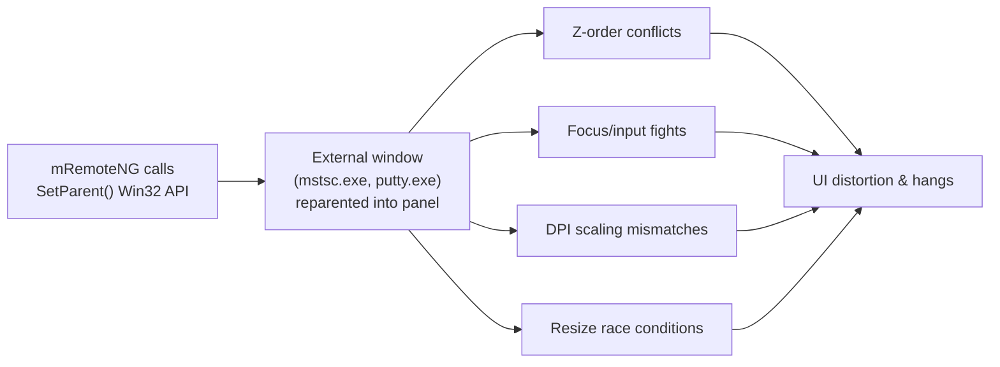
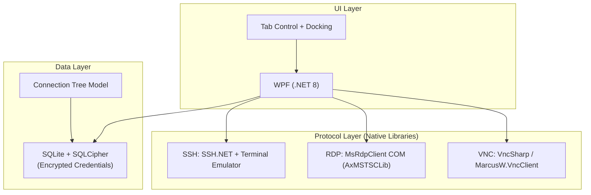
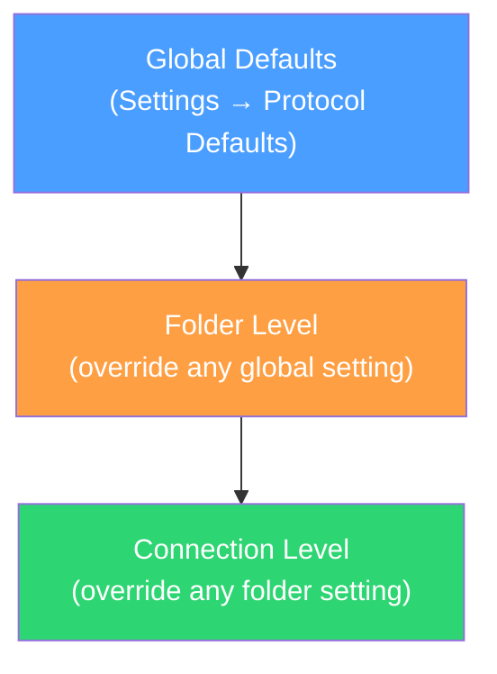
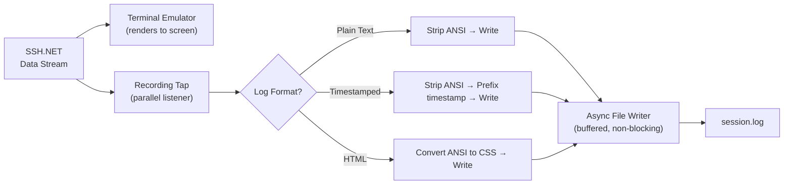
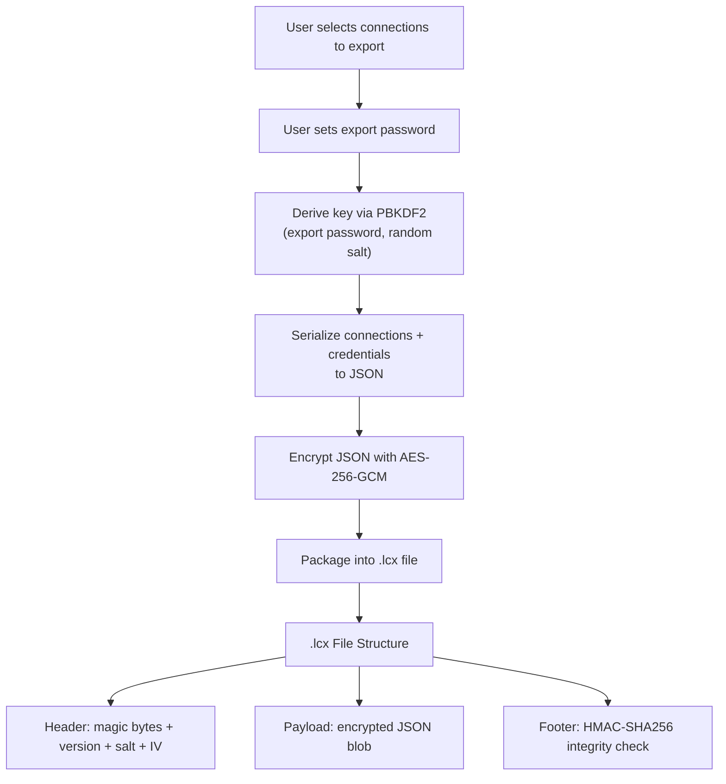
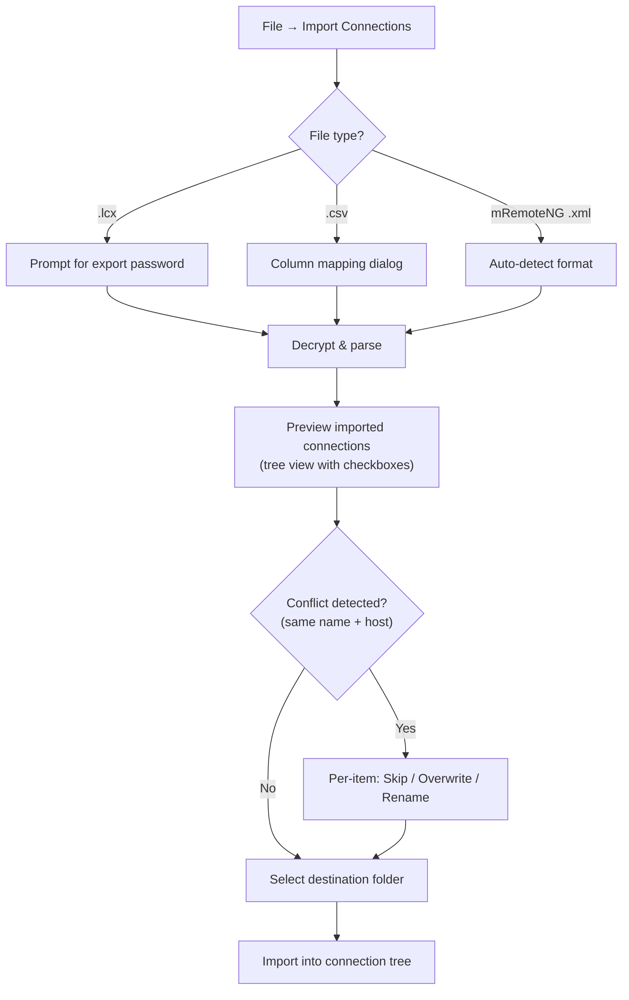
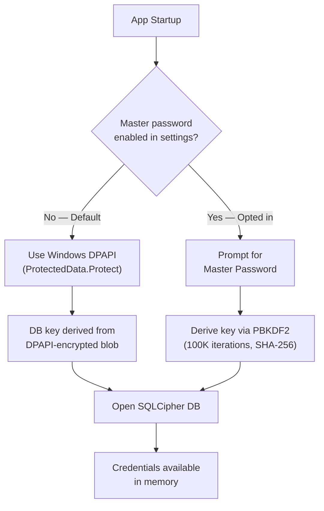
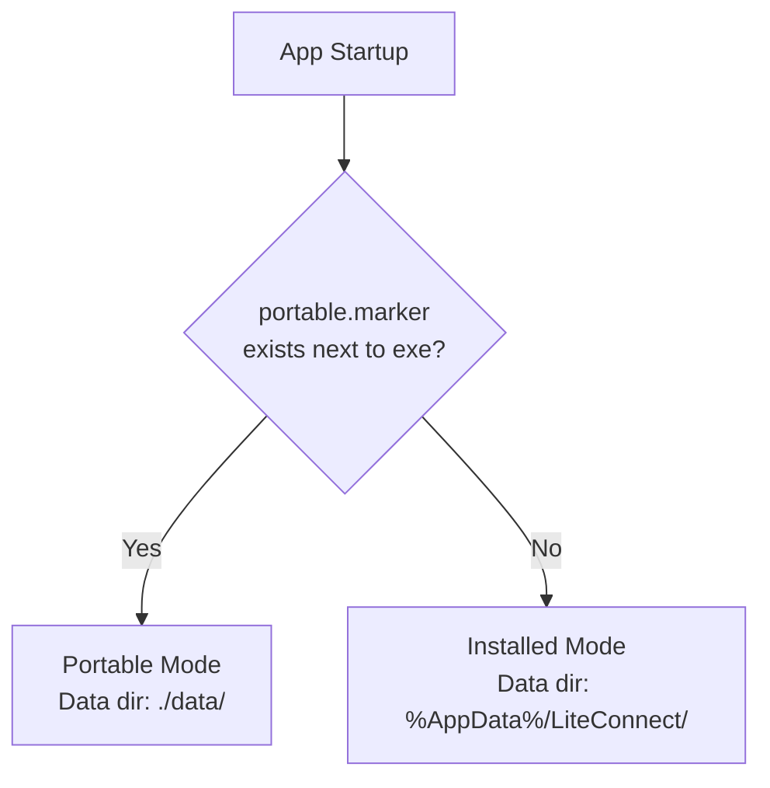

# 🖥️ LiteConnect — Lightweight Multi-Tab Remote Connection Manager

## Executive Summary

Build a modern, lightweight Windows application for managing SSH, RDP, and VNC connections in a tabbed interface — addressing the architectural flaws that make mRemoteNG unreliable.

> [!IMPORTANT]
> The key differentiator is **using native protocol libraries** instead of embedding external application windows via `SetParent()` — the root cause of mRemoteNG's instability.

---

## 1. Why This Isn't Redundant

### Root Cause Analysis: Why mRemoteNG Breaks



**mRemoteNG's architecture is the problem, not just its implementation.** Reparenting windows from separate processes into your own UI is fighting Windows' window manager. No amount of patching fixes this.

### Market Gap

| Feature | mRemoteNG | MobaXterm | Royal TS | **LiteConnect** |
|---------|-----------|-----------|----------|-----------------|
| Free & Open Source | ✅ | ❌ (limited free) | ❌ | ✅ |
| Lightweight (<30 MB) | ❌ (~80 MB) | ❌ (~150 MB) | ❌ | ✅ |
| Native protocol rendering | ❌ (embeds windows) | ✅ | ✅ | ✅ |
| Modern UI framework | ❌ (WinForms) | ❌ | ✅ | ✅ |
| No hangs/UI glitches | ❌ | ⚠️ | ✅ | ✅ |
| Active development | ⚠️ (sporadic) | ✅ | ✅ | ✅ |

---

## 2. Technical Architecture

### 2.1 Technology Stack



#### Why This Stack?

| Choice | Rationale |
|--------|-----------|
| **WPF on .NET 8** | Modern, hardware-accelerated rendering; excellent tabbing/docking support; single-file publish possible; much lighter than Electron/web alternatives |
| **SSH.NET** | Pure .NET SSH library — no external process needed; supports SSH2, SFTP, port forwarding |
| **AxMSTSCLib (RDP ActiveX)** | Microsoft's official RDP client COM control — renders natively inside WPF; same engine as `mstsc.exe` but **hosted in-process** (no `SetParent()` hack) |
| **VncSharp / MarcusW.VncClient** | Pure .NET VNC implementation — renders directly to a WPF canvas |
| **SQLite + SQLCipher** | Encrypted at-rest credential storage; single file; no external DB needed |

> [!NOTE]
> The critical distinction: mRemoteNG launches `mstsc.exe` as a **separate process** and reparents its window. We use the **RDP ActiveX control hosted in-process** — it renders directly in our UI like a native control. Same technology, completely different integration pattern.

### 2.2 Project Structure

```
LiteConnect/
├── src/
│   ├── LiteConnect.App/              # WPF Application (entry point)
│   │   ├── App.xaml
│   │   ├── MainWindow.xaml           # Shell with tab bar + connection tree
│   │   ├── Views/
│   │   │   ├── ConnectionTreeView.xaml
│   │   │   ├── SshTabView.xaml
│   │   │   ├── RdpTabView.xaml
│   │   │   ├── VncTabView.xaml
│   │   │   └── SettingsView.xaml
│   │   └── ViewModels/
│   │       ├── MainViewModel.cs
│   │       ├── ConnectionTreeViewModel.cs
│   │       ├── SshSessionViewModel.cs
│   │       ├── RdpSessionViewModel.cs
│   │       └── VncSessionViewModel.cs
│   │
│   ├── LiteConnect.Core/             # Core business logic (no UI deps)
│   │   ├── Models/
│   │   │   ├── ConnectionInfo.cs     # SSH/RDP/VNC connection model
│   │   │   ├── ConnectionGroup.cs    # Folder/group model
│   │   │   └── ProtocolType.cs       # Enum: SSH, RDP, VNC
│   │   ├── Services/
│   │   │   ├── IConnectionManager.cs
│   │   │   ├── ConnectionManager.cs
│   │   │   ├── ICredentialStore.cs
│   │   │   └── CredentialStore.cs    # SQLCipher-backed
│   │   └── Import/
│   │       └── MRemoteNGImporter.cs  # Import from mRemoteNG XML
│   │
│   ├── LiteConnect.Protocols/        # Protocol implementations
│   │   ├── Ssh/
│   │   │   ├── SshSession.cs
│   │   │   └── TerminalEmulator.cs   # ANSI/VT100 terminal rendering
│   │   ├── Rdp/
│   │   │   └── RdpSession.cs         # AxMSTSCLib wrapper
│   │   └── Vnc/
│   │       └── VncSession.cs
│   │
│   └── LiteConnect.Terminal/         # Terminal emulator control
│       ├── TerminalControl.xaml       # WPF control for SSH terminal
│       ├── TerminalBuffer.cs          # Screen buffer + scrollback
│       └── AnsiParser.cs             # VT100/xterm escape sequence parser
│
├── tests/
│   ├── LiteConnect.Core.Tests/
│   └── LiteConnect.Protocols.Tests/
│
├── LiteConnect.sln
└── README.md
```

---

## 2.3 Protocol Configuration Options

Each protocol exposes a **tabbed properties dialog** when creating/editing a connection. Settings use an inheritance model — defaults at the global level, overridable per-folder, overridable per-connection.

### RDP Configuration

| Category | Setting | Default | Notes |
|----------|---------|---------|-------|
| **Connection** | Hostname | — | Required |
| | Port | `3389` | |
| | Username | — | Inheritable from parent folder |
| | Password | — | Stored encrypted in SQLCipher |
| | Domain | — | Windows domain for auth |
| **RD Gateway** | Use Gateway | `No` | Enable/disable gateway |
| | Gateway Server | — | FQDN of RD Gateway |
| | Gateway Port | `443` | |
| | Gateway Credentials | `Same as connection` | Separate credentials or inherit |
| | Gateway Auth Method | `Password` | Password / Smart Card |
| | Bypass Gateway for Local | `Yes` | Skip gateway for LAN addresses |
| **Display** | Resolution | `Auto (fit to tab)` | Auto / Match monitor / Custom WxH / Fullscreen |
| | Color Depth | `32-bit` | 15 / 16 / 24 / 32 bit |
| | Smart Sizing | `Yes` | Scale RDP to fit tab on resize |
| | DPI Scaling | `Match local` | Match local / 100% / 125% / 150% / 200% |
| **Local Resources** | Audio Playback | `Local` | Play on this computer / Remote / Do not play |
| | Audio Recording | `Do not record` | Record from this computer / Do not record |
| | Keyboard Shortcuts | `In full screen only` | On this computer / Remote / In full screen |
| | Clipboard Redirect | `Yes` | Share clipboard |
| | Printer Redirect | `No` | Redirect local printers |
| | Drive Redirect | `None` | None / All drives / Specific drives |
| | Smart Card Redirect | `No` | Pass through local smart cards |
| | USB Redirect | `No` | Redirect USB devices (RemoteFX) |
| **Experience / Performance** | Connection Speed | `Auto detect` | Modem / Broadband (Low) / Broadband (High) / LAN / Auto |
| | Desktop Background | `Auto` | Show/hide based on speed |
| | Font Smoothing | `Auto` | ClearType on/off |
| | Desktop Composition | `Auto` | Aero/DWM effects |
| | Visual Styles | `Auto` | Themes and window styling |
| | Persistent Bitmap Caching | `Yes` | Cache bitmaps to disk |
| **Security** | Authentication Level | `NLA (default)` | NLA / TLS / RDP-level |
| | Enable CredSSP | `Yes` | |
| **Startup Program** | Start Program | — | Path to program on remote host |
| | Working Directory | — | Start-in directory for the program |
| **Advanced** | Console/Admin Session | `No` | Connect to console session |
| | Load Balancing Info | — | For RD Connection Broker |
| | Connection Timeout | `30 sec` | |
| | Auto Reconnect | `Yes` | Reconnect on drop (up to 20 attempts) |

### SSH Configuration

| Category | Setting | Default | Notes |
|----------|---------|---------|-------|
| **Connection** | Hostname | — | Required |
| | Port | `22` | |
| | Username | — | Inheritable from parent folder |
| **Authentication** | Auth Method | `Password` | Password / Private Key / Key + Password / Agent / Keyboard-Interactive |
| | Password | — | Stored encrypted |
| | Private Key File | — | Path to PEM / OpenSSH key file |
| | Key Passphrase | — | Stored encrypted if set |
| | PuTTY Key (.ppk) | — | Auto-converts PPK to OpenSSH format |
| | SSH Agent Forwarding | `No` | Forward local SSH agent |
| **Proxy** | Proxy Type | `None` | None / HTTP / SOCKS4 / SOCKS5 / SSH (jump host) |
| | Proxy Host | — | |
| | Proxy Port | — | Default varies by type (1080 for SOCKS, 8080 for HTTP) |
| | Proxy Username | — | |
| | Proxy Password | — | Stored encrypted |
| | SSH Jump Host | — | SSH hop-through host (`user@host:port`) |
| **Terminal** | Terminal Type | `xterm-256color` | xterm / xterm-256color / vt100 / vt220 |
| | Character Encoding | `UTF-8` | UTF-8 / Latin-1 / ASCII / etc. |
| | Columns × Rows | `Auto (fit to tab)` | Auto-resize or fixed |
| | Scrollback Lines | `10,000` | 1K–100K or unlimited |
| | Font Family | `Cascadia Mono` | Monospace font selection |
| | Font Size | `12` | |
| | Color Scheme | `Default Dark` | Preset themes or custom 16-color palette |
| | Bell Action | `Visual` | Visual flash / System sound / None |
| | Cursor Style | `Block` | Block / Underline / Bar |
| | Cursor Blink | `Yes` | |
| **Tunneling** | Local Port Forwards | — | List of `localPort:remoteHost:remotePort` |
| | Remote Port Forwards | — | List of `remotePort:localHost:localPort` |
| | Dynamic (SOCKS) Proxy | — | Local port for dynamic forwarding |
| **Keep-alive** | Send Keep-alive | `Yes` | |
| | Keep-alive Interval | `60 sec` | |
| | TCP Keep-alive | `Yes` | OS-level TCP keepalive |
| **Post-connect** | Startup Command | — | Command to execute after login |
| | Expect Script | — | Simple expect-style auto-interaction (for sudo prompts, etc.) |
| **Advanced** | Compression | `No` | Enable zlib compression |
| | Preferred Ciphers | `aes256-ctr, aes128-ctr, aes256-gcm` | Ordered cipher preference list |
| | Preferred MACs | `hmac-sha2-256, hmac-sha2-512` | Ordered MAC preference |
| | Key Exchange | `curve25519-sha256, ecdh-sha2-nistp256` | Ordered KEX preference |
| | Host Key Algorithms | `ssh-ed25519, ecdsa-sha2-nistp256, rsa-sha2-512` | Ordered host key preference |
| | Connection Timeout | `15 sec` | |
| | Auto Reconnect | `Yes` | Reconnect on drop |

### VNC Configuration

| Category | Setting | Default | Notes |
|----------|---------|---------|-------|
| **Connection** | Hostname | — | Required |
| | Port | `5900` | Display `:0` = 5900, `:1` = 5901, etc. |
| | VNC Password | — | Stored encrypted |
| **Display** | Color Depth | `Auto` | Auto / Full Color / 256 Colors / 64 Colors / 8 Colors |
| | Scaling Mode | `Fit to tab` | Fit to tab / Scroll / 100% / Custom % |
| | View-only Mode | `No` | Disable keyboard/mouse input |
| **Encoding** | Preferred Encoding | `Tight` | Tight / ZRLE / Hextile / CopyRect / Raw |
| | Compression Level | `Auto` | 0–9 (Tight/ZRLE) |
| | JPEG Quality | `6` | 0–9 (Tight encoding only) |
| | Use CopyRect | `Yes` | Optimize screen scrolling |
| **Proxy** | Proxy Type | `None` | None / HTTP / SOCKS4 / SOCKS5 |
| | Proxy Host | — | |
| | Proxy Port | — | |
| | Proxy Credentials | — | |
| | SSH Tunnel | — | Tunnel VNC over SSH (host:port + SSH creds) |
| **Security** | Security Type | `Auto-negotiate` | None / VNC Auth / VeNCrypt / TLS |
| | TLS Certificate Validation | `Warn` | Accept / Warn / Reject untrusted |
| **Input** | Share Clipboard | `Yes` | Sync clipboard with remote |
| | Local Cursor | `Dot` | Dot / Arrow / None |
| | Pass Special Keys | `Yes` | Ctrl+Alt+Del, etc. |
| **Advanced** | Shared Session | `Yes` | Allow multiple VNC viewers |
| | Connection Timeout | `15 sec` | |
| | Auto Reconnect | `Yes` | |

### Configuration Inheritance Model



Each setting shows its effective value and source:
- **Bold** = explicitly set at this level
- *Italic (inherited)* = inherited from parent folder or global default
- Right-click any field → "Reset to inherited" / "Set at this level"

### Updated Data Models

```
LiteConnect.Core/Models/
├── ConnectionInfo.cs            # Base: Id, Name, Host, Port, ParentGroup
├── ProtocolType.cs              # Enum: SSH, RDP, VNC
├── ConnectionGroup.cs           # Folder node with inherited settings
├── RdpConnectionSettings.cs     # All RDP-specific settings (nullable for inheritance)
├── SshConnectionSettings.cs     # All SSH-specific settings (nullable for inheritance)
├── VncConnectionSettings.cs     # All VNC-specific settings (nullable for inheritance)
├── ProxySettings.cs             # Shared proxy config (type, host, port, creds)
├── PortForwardRule.cs           # Local/Remote/Dynamic forward definition
└── GlobalDefaults.cs            # App-wide default values per protocol
```

> [!TIP]
> **Nullable pattern for inheritance**: Each setting property is `T?` (nullable). `null` means "inherit from parent." The `EffectiveSettings` resolver walks up the tree to find the first non-null value, falling back to `GlobalDefaults`. This gives clean three-tier inheritance without duplicating values.

### Connection Properties Dialog Layout

```
┌──────────────────────────────────────────────┐
│  Connection Properties: web-server-01        │
├──────────────────────────────────────────────┤
│ ┌──────────┬──────────┬──────────┬─────────┐ │
│ │Connection│ Display  │ Gateway  │Resources│ │
│ │          │          │          │         │ │
│ ├──────────┴──────────┴──────────┴─────────┤ │
│ │                                          │ │
│ │  Hostname:  [web-server-01           ]   │ │
│ │  Port:      [3389    ]                   │ │
│ │  Username:  [admin   ]  (inherited)      │ │
│ │  Password:  [••••••••]  (inherited)      │ │
│ │  Domain:    [CORP     ]                  │ │
│ │                                          │ │
│ │  ☐ Override inherited credentials        │ │
│ │                                          │ │
│ ├──────────────────────────────────────────┤ │
│ │          [OK]    [Cancel]    [Apply]      │ │
│ └──────────────────────────────────────────┘ │
└──────────────────────────────────────────────┘
```

---

## 2.4 SSH Session Recording

The terminal emulator captures all text output from SSH sessions and can record it to a file — either automatically or on demand.

### Recording Modes

| Mode | Description |
|------|-------------|
| **Manual** | User clicks 🔴 Record button in the SSH tab toolbar, chooses file path, recording starts. Click ⏹ Stop to end. |
| **Auto per-session** | Configured per-connection: every time this connection opens, recording starts automatically to a predefined path. |
| **Auto global** | Configured in Settings → SSH → Session Recording: record ALL SSH sessions to a log directory. |

### Session Recording Settings (per-connection)

| Setting | Default | Notes |
|---------|---------|-------|
| Auto-record | `No` | Start recording when session connects |
| Log Directory | `%USERPROFILE%\Documents\LiteConnect\Logs\` | Base directory for log files |
| File Name Pattern | `{connection}_{date}_{time}.log` | Supports variables: `{connection}`, `{host}`, `{user}`, `{date}`, `{time}`, `{datetime}` |
| Log Format | `Plain Text` | Plain Text / Timestamped / HTML (with colors) |
| Append or Overwrite | `Append` | If file already exists |
| Max File Size | `Unlimited` | Auto-rotate when size exceeded |
| Log Rotation | `None` | None / Daily / Per-session / By size |

### Log Format Examples

**Plain Text** — raw terminal output, stripped of ANSI escape sequences:
```
$ hostname
web-server-01
$ uptime
 14:32:01 up 42 days, 3:17, 2 users, load average: 0.15, 0.10, 0.08
$ df -h /
Filesystem      Size  Used Avail Use% Mounted on
/dev/sda1        50G   18G   30G  38% /
```

**Timestamped** — each line prefixed with timestamp:
```
[2026-09-27 14:32:01.123] $ hostname
[2026-09-27 14:32:01.456] web-server-01
[2026-09-27 14:32:03.789] $ uptime
[2026-09-27 14:32:03.901]  14:32:01 up 42 days, 3:17, 2 users, load average: 0.15, 0.10, 0.08
```

**HTML (with colors)** — preserves ANSI colors as HTML/CSS for later viewing in a browser:
```html
<pre style="background:#1e1e1e;color:#d4d4d4;">
<span style="color:#6a9955;">$ </span>hostname
web-server-01
<span style="color:#6a9955;">$ </span>uptime
 14:32:01 up 42 days...
</pre>
```

### Recording Architecture



> [!TIP]
> The recording tap sits on the raw SSH data stream **before** the terminal emulator processes it. This means recording never impacts rendering performance — writes are buffered and flushed asynchronously to disk.

### UI Integration

```
┌─── SSH: web-server-01 ────────────────────────────────────┐
│ 🔴 Recording ─ web-server-01_2026-09-27_143201.log │ ⏹ ⏸ │
├───────────────────────────────────────────────────────────┤
│ $ hostname                                                │
│ web-server-01                                             │
│ $ _                                                       │
└───────────────────────────────────────────────────────────┘
```

- Status bar shows recording indicator (🔴), file path, and stop/pause buttons
- Right-click tab → "Start Recording" / "Stop Recording"
- Keyboard shortcut: `Ctrl+Shift+R` to toggle recording

---

## 2.5 Export / Import System

Sessions and credentials must be portable — shareable with colleagues or movable to another computer.

### Export Formats

| Format | Includes Credentials | Use Case |
|--------|---------------------|----------|
| **Encrypted Bundle** (`.lcx`) | ✅ Yes (AES-256 encrypted) | Full backup, sharing with trusted colleagues |
| **Sessions Only** (`.lcx`) | ❌ No (credentials stripped) | Share connection list without exposing passwords |
| **CSV** | ❌ No | Bulk import into spreadsheets or other tools |
| **mRemoteNG XML** | Optional | Interoperability with mRemoteNG users |

### Encrypted Bundle (`.lcx`) Format



> [!IMPORTANT]
> The export password is **independent** of the app's master password. This allows sharing a bundle with a colleague using a separate password communicated out-of-band (e.g., in person, via phone). The recipient doesn't need to know your master password.

### `.lcx` File Structure (Binary)

```
Offset  Size     Field
──────  ───────  ──────────────────────────────
0x00    4 bytes  Magic: "LCX\x01"
0x04    2 bytes  Format version (uint16)
0x06    1 byte   Flags (bit 0: includes credentials, bit 1: includes SSH keys)
0x07    32 bytes PBKDF2 salt
0x27    12 bytes AES-GCM IV/nonce
0x33    4 bytes  Payload length (uint32)
0x37    N bytes  AES-256-GCM encrypted payload (JSON)
0x37+N  16 bytes AES-GCM authentication tag
```

### Export Options Dialog

```
┌──────────────────────────────────────────────┐
│  Export Connections                           │
├──────────────────────────────────────────────┤
│                                              │
│  Export scope:                                │
│    ◉ Selected connections (3 selected)       │
│    ○ Selected folder: "Production Servers"   │
│    ○ All connections                         │
│                                              │
│  Format:                                     │
│    [▼ Encrypted Bundle (.lcx)            ]   │
│                                              │
│  ☑ Include credentials (passwords & keys)    │
│  ☑ Include SSH private keys                  │
│  ☐ Include session recording settings        │
│  ☑ Preserve folder structure                 │
│                                              │
│  Export password:  [••••••••••            ]   │
│  Confirm password: [••••••••••            ]   │
│  Strength: ████████░░ Strong                 │
│                                              │
│          [Export]           [Cancel]          │
└──────────────────────────────────────────────┘
```

### Import Workflow



### Import Conflict Resolution

| Scenario | Options |
|----------|---------|
| Connection with same name exists in target folder | **Skip** / **Overwrite** (replace settings+credentials) / **Rename** (append suffix) / **Keep Both** |
| Folder with same name exists | **Merge** contents / **Rename** folder |
| Credential differs for same host+user | **Keep existing** / **Use imported** / **Ask for each** |

### Data Models

```
LiteConnect.Core/
├── Import/
│   ├── MRemoteNGImporter.cs       # Parse mRemoteNG confCons.xml
│   ├── CsvImporter.cs             # Parse CSV with column mapping
│   └── LcxImporter.cs             # Decrypt and parse .lcx bundles
├── Export/
│   ├── LcxExporter.cs             # Encrypt and package .lcx bundles
│   ├── CsvExporter.cs             # Export to CSV (no credentials)
│   └── MRemoteNGExporter.cs       # Export to mRemoteNG XML format
└── Services/
    └── SessionRecordingService.cs # Manages recording lifecycle per SSH tab
```

---

## 3. Feature Roadmap

### Phase 1 — MVP (Core Connections) 🎯
> Goal: Replace mRemoteNG for the most common use cases

- [ ] **Tabbed interface** with drag-and-drop tab reordering
- [ ] **Connection tree** (left panel) with folders and drag-drop organization
- [ ] **RDP connections** via in-process AxMSTSCLib ActiveX control
  - Auto-resize to tab size
  - Configurable: resolution, color depth, audio redirection, drive mapping
  - Smart reconnect on disconnect
- [ ] **SSH connections** via SSH.NET with built-in terminal emulator
  - VT100/xterm escape sequence support
  - Configurable font, colors, scrollback buffer
  - Key-based authentication support (PEM, PPK via PuTTYgen conversion)
- [ ] **SSH session recording** — record terminal text to file (see §2.4 below)
- [ ] **Credential storage** — encrypted at rest
  - Default: Windows DPAPI encryption (transparent, no password prompt)
  - Optional: master password for extra security (e.g., shared machines, USB portability)
  - Per-connection or inherited credentials
- [ ] **Export / Import** — portable session+credential bundles (see §2.5 below)
- [ ] **Connection import** from mRemoteNG XML files
- [ ] **Quick Connect** bar (type hostname, select protocol, connect)

### Phase 2 — Productivity Features
> Goal: Match MobaXterm's productivity without the bloat

- [ ] **SFTP panel** integrated with SSH sessions (auto-opens alongside SSH tab)
- [ ] **SSH port forwarding** (local, remote, dynamic/SOCKS)
- [ ] **Multi-execution** — send same command to multiple SSH sessions
- [ ] **Credential inheritance** — set credentials at folder level, children inherit
- [ ] **Search** across connection tree
- [ ] **Command snippets** — save and quick-execute frequent commands

### Phase 3 — Polish & Power Features

- [ ] **Tabbed groups / split view** — view multiple sessions side-by-side
- [ ] **VNC connections** via native VNC library
- [ ] **Telnet connections** — raw TCP terminal (port 23 default, configurable)
- [ ] **Themes** — dark/light mode
- [ ] **Windows credential integration** — optionally use Windows Credential Manager
- [ ] **Auto-login scripts** — post-connection command execution
- [ ] **Optional installer** — MSI/MSIX for enterprise deployment (GPO/SCCM/Intune)

### Phase 4 — Future Enhancements (Deferred)

- [ ] **SSH key management** — generate key pairs, convert PPK↔PEM
- [ ] **Serial port connections** — COM port terminal
- [ ] **Plugin system** — extensible protocol support
- [ ] **Cloud sync** — optional encrypted sync of connection database (OneDrive/Google Drive)
- [ ] **Wake-on-LAN** — send WOL packet before connecting

---

## 4. Key Design Decisions

### 4.1 SSH: Native Library vs. Embedding PuTTY

| Approach | Pros | Cons |
|----------|------|------|
| **SSH.NET + custom terminal** ✅ | No external dependency; full control over rendering; no `SetParent()` bugs; supports programmatic interaction (auto-login, multi-exec) | Must build terminal emulator; significant VT100/xterm work |
| **Embed PuTTY window** | Battle-tested terminal; less dev work initially | Same `SetParent()` problems as mRemoteNG; can't programmatically interact; external dependency |

> [!TIP]
> **Recommendation: SSH.NET + custom terminal.** The terminal emulator is the hardest part, but there are open-source .NET terminal controls we can build on (e.g., [AvaloniaTerminal](https://github.com/nickvdyck/AvaloniaTerminal), [Terminal.Gui](https://github.com/gui-cs/Terminal.Gui), or port concepts from [xterm.js](https://xtermjs.org/)). This eliminates the entire class of window-embedding bugs.

### 4.2 RDP: ActiveX Control vs. External Process

| Approach | Pros | Cons |
|----------|------|------|
| **AxMSTSCLib ActiveX** ✅ | In-process rendering; native resize; programmatic control (connect/disconnect/settings); Microsoft-supported | COM interop complexity; limited to Windows |
| **Launch mstsc.exe + SetParent** | Zero protocol code | All of mRemoteNG's problems |
| **FreeRDP** | Cross-platform; full control | Complex native interop; less Windows-integrated |

> [!TIP]
> **Recommendation: AxMSTSCLib.** This is the same RDP engine as `mstsc.exe`, but hosted as a COM control inside your WPF app. It renders directly in your UI — no window reparenting. This is the correct way to embed RDP.

### 4.3 Credential Security (Dual-Mode)

Master password is **optional**. By default, credentials are encrypted transparently using Windows DPAPI — no prompt on startup.



| Mode | How It Works | When To Use |
|------|-------------|-------------|
| **DPAPI (default)** | Windows encrypts the DB key using the logged-in user's credentials. App opens silently — no password prompt. | Single-user machine, your own laptop/workstation |
| **Master Password (opt-in)** | User sets a password in Settings → Security. Required on every app launch. | Shared machines, USB portable use, extra paranoia |

> [!NOTE]
> **DPAPI caveat for portable mode**: DPAPI encryption is tied to the Windows user account. If you copy LiteConnect to a USB and run it on a different PC/user, DPAPI-encrypted credentials **won't decrypt**. The app detects this and prompts you to re-enter passwords. For USB portability, enable master password mode — it travels with the app.

- Credentials encrypted at rest via SQLCipher (AES-256) regardless of mode
- DPAPI mode: DB key stored as a DPAPI-protected blob in `data/dpapi.key`
- Master password mode: key derived from password + salt, no key file on disk
- User can switch modes in Settings → Security (re-encrypts the database)
- Optional: Windows Hello for biometric unlock (enhances either mode)

### 4.4 Portable-First Architecture

LiteConnect is **portable by default** — no installation required, runs from any folder or USB stick.

#### Directory Layout (Portable)

```
LiteConnect/                      ← copy this folder anywhere
├── LiteConnect.exe               ← single self-contained executable
├── data/
│   ├── connections.db            ← SQLCipher encrypted database
│   ├── dpapi.key                 ← DPAPI-encrypted DB key (default mode)
│   ├── settings.json             ← app preferences (non-sensitive)
│   └── known_hosts               ← SSH host key fingerprints
├── logs/                         ← session recordings (if configured)
│   ├── web-server-01_2026-09-27_143201.log
│   └── ...
└── portable.marker               ← presence of this file = portable mode
```

#### Build Configuration

```xml
<!-- LiteConnect.App.csproj -->
<PropertyGroup>
    <TargetFramework>net8.0-windows</TargetFramework>
    <UseWPF>true</UseWPF>
    <UseWindowsForms>true</UseWindowsForms>   <!-- for WindowsFormsHost (RDP ActiveX) -->
    <!-- No RuntimeIdentifier here — AnyCPU for development -->
    <PublishSingleFile>true</PublishSingleFile>
    <SelfContained>true</SelfContained>
    <IncludeNativeLibrariesForSelfExtract>true</IncludeNativeLibrariesForSelfExtract>
    <EnableCompressionInSingleFile>true</EnableCompressionInSingleFile>
</PropertyGroup>
```

**Publish scripts** (produce both architectures):
```powershell
# Build both portable packages
dotnet publish -c Release -r win-x64   --self-contained -o ./publish/win-x64
dotnet publish -c Release -r win-arm64 --self-contained -o ./publish/win-arm64
```

| Build Mode | RID | Use Case |
|-----------|-----|----------|
| `dotnet build` (dev) | AnyCPU | Day-to-day development on your ARM64 machine |
| `dotnet publish -r win-x64` | x64 | Portable package for x64 Windows machines |
| `dotnet publish -r win-arm64` | ARM64 | Portable package for ARM64 Windows (Snapdragon, M-series via Parallels) |

- **Single exe** per architecture includes .NET 8 runtime — no framework install needed
- Compressed single file: ~30–40 MB each
- Native SQLCipher DLL auto-selected per RID via NuGet runtime packages
- RDP ActiveX (AxMSTSCLib) is a system COM control — available natively on both architectures

#### Portable vs. Installed Detection



> [!TIP]
> This dual-mode approach means we can ship a portable zip **and** an installer from the same codebase. The installer simply omits the `portable.marker` file, and the app uses `%AppData%` instead.

### 4.5 SSH Key File Support

For Phase 1, LiteConnect **points to existing key files** — no key generation or conversion.

| Feature | Supported |
|---------|-----------|
| Browse for private key file | ✅ File picker dialog |
| OpenSSH format keys (PEM) | ✅ Native SSH.NET support |
| PuTTY format keys (.ppk) | ✅ SSH.NET reads PPK v2/v3 natively |
| Encrypted private keys | ✅ Prompt for passphrase, optionally save encrypted |
| SSH agent (Pageant) | ✅ SSH.NET supports Pageant agent |
| Key generation / conversion | ❌ Deferred to Phase 4 |

---

## 5. Technical Risks & Mitigations

| Risk | Impact | Mitigation |
|------|--------|------------|
| **Terminal emulator complexity** | VT100/xterm has hundreds of escape sequences | Start with core sequences (cursor movement, colors, scrolling); use xterm.js test suite for validation; iterate based on real-world SSH usage |
| **RDP ActiveX in WPF** | COM interop + WPF airspace issues | Use `WindowsFormsHost` to embed the WinForms ActiveX wrapper; this is well-documented and used in production by other tools |
| **VNC performance** | Software rendering may be slow for large screens | Use GPU-accelerated bitmap rendering in WPF; implement incremental frame updates; defer to Phase 3 |
| **Credential security** | Single point of failure if master password is weak | Enforce minimum password strength; offer Windows Hello as alternative; implement auto-lock after idle timeout |

---

## 6. Development Effort Estimate

| Phase | Estimated Effort | Key Deliverables |
|-------|-----------------|------------------|
| **Phase 1 (MVP)** | 6–8 weeks | RDP + SSH connections, tabbed UI, connection tree, credential storage, export/import, session recording |
| **Phase 2** | 4–6 weeks | SFTP, port forwarding, multi-exec, search, command snippets |
| **Phase 3** | 4–6 weeks | VNC, Telnet, split view, themes, optional installer |
| **Phase 4** | 2–4 weeks | SSH key management, serial ports, plugin system |

> [!NOTE]
> The terminal emulator is the single largest piece of work in Phase 1. Consider using or forking an existing .NET terminal library to accelerate this.

---

## 7. Recommended Starting Point

For the first sprint, I'd suggest this order:

1. **Scaffold the WPF app** with tab control and connection tree panel
2. **Set up portable-first data layer** — `portable.marker` detection, `./data/` directory
3. **Implement RDP first** — AxMSTSCLib is well-documented and gives a visible win quickly
4. **Implement credential storage** with SQLCipher
5. **Build the SSH terminal** — start with SSH.NET connection + basic character rendering, then iterate on escape sequence support
6. **Add session recording** — tap on SSH data stream with async file writer
7. **Add export/import** — `.lcx` encrypted bundles
8. **Add connection import** from mRemoteNG

---

## 8. Decisions Log

| # | Question | Decision |
|---|----------|----------|
| 1 | App name | **LiteConnect** ✅ |
| 2 | SSH key management | **Point to existing key files** (PEM, PPK, Pageant) — key generation deferred to Phase 4 |
| 3 | Portable vs. installed | **Portable-first** — single self-contained exe with `./data/` directory; optional installer in Phase 3 |
| 4 | Telnet/Serial | **Telnet in Phase 3**, serial ports in Phase 4 |
| 5 | Export/Import | **Phase 1 (MVP)** — encrypted `.lcx` bundles with independent password |
| 6 | Session recording | **Phase 1 (MVP)** — manual + auto modes, plain text / timestamped / HTML formats |
| 7 | Master password | **Optional** — DPAPI encryption by default (no prompt); master password opt-in via Settings → Security |
| 8 | Architecture | **Both x64 and ARM64** — AnyCPU for dev, separate self-contained publish per RID for release |

### Remaining Question

1. **Ready to start building Phase 1?**
